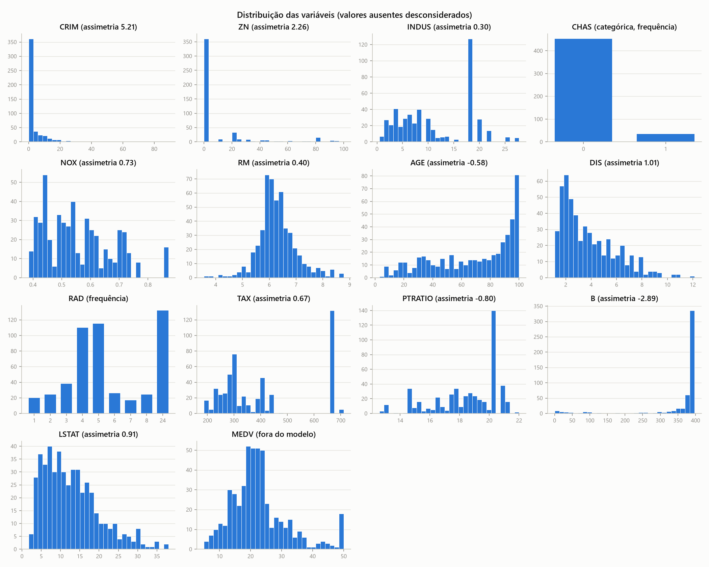
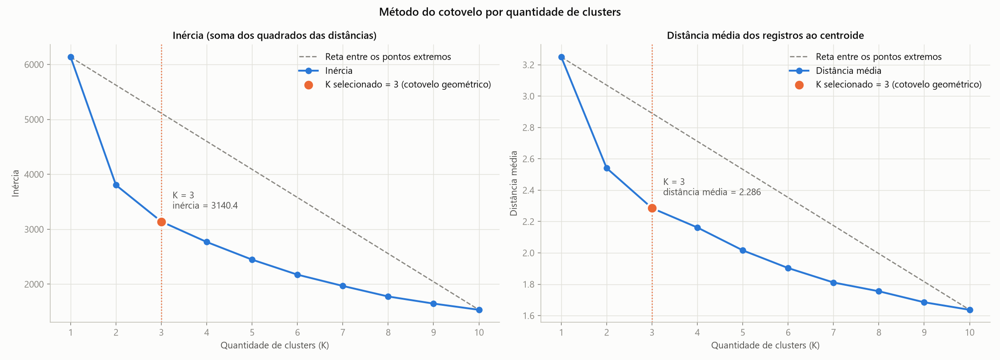
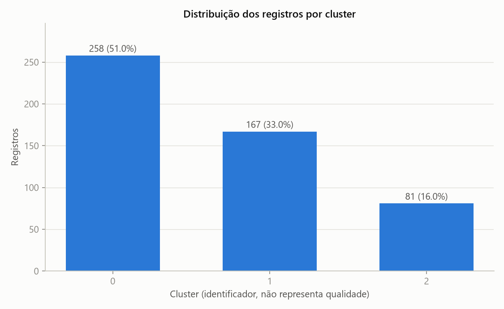

# Boston Housing K-Means

Clusterização de regiões censitárias de Boston com K-Means, com treinamento reproduzível e inferência de novos registros por terminal ou JSON.

> **Requisito: Python 3.12 ou superior.** As versões fixadas em `requirements.txt` exigem Python 3.12 no mínimo (numpy 2.5.4 e scipy 1.18.1). O projeto foi validado com Python 3.12.7 e 3.14.3 no Windows 11.

## Como executar

Na pasta raiz do projeto, crie e ative um ambiente virtual.

```bash
python -m venv .venv
```

No Windows (PowerShell):

```bash
.\.venv\Scripts\Activate.ps1
```

No Linux ou macOS:

```bash
source .venv/bin/activate
```

Instale as dependências:

```bash
pip install -r requirements.txt
```

Treine o modelo oficial (K = 3). A base já está em `data/HousingData.csv`.

```bash
python -m src.train
```

Classifique uma nova observação digitando os valores no terminal:

```bash
python -m src.inference
```

Ou usando o arquivo JSON de exemplo:

```bash
python -m src.inference --json examples/nova_residencia.json
```

Para rodar os testes automatizados:

```bash
pytest -v
```

Os detalhes de cada comando estão em [Execução](#execução).

## Objetivo

Identificar perfis de regiões a partir de características estruturais, ambientais, geográficas e socioeconômicas, sem usar o valor dos imóveis (`MEDV`). O projeto tem duas etapas independentes:

1. **Treinamento** (`python -m src.train`): analisa os dados, escolhe K, treina o modelo e salva o artefato.
2. **Inferência** (`python -m src.inference`): carrega o artefato e classifica uma nova observação, sem treinar novamente.

O K-Means divide os registros em K grupos, alternando entre atribuir cada registro ao centroide mais próximo e recalcular cada centroide como a média de seu grupo. O processo minimiza a inércia, que é a soma dos quadrados das distâncias euclidianas entre os registros e seus centroides.

> **Finalidade exploratória e demonstrativa.** Os agrupamentos não são classificações objetivas da qualidade de uma região, e o modelo não deve ser usado isoladamente em decisões reais de crédito, moradia, investimento ou avaliação imobiliária. Veja [Limitações](#limitações-da-base).

### Registros são regiões, não residências

Cada linha da base descreve uma **região censitária**, e não uma residência isolada. Por isso, a interface usa a expressão "nova residência", mas a inferência representa tecnicamente um novo perfil de região com as mesmas 13 características.

## Tecnologias

| Biblioteca | Uso |
|---|---|
| scikit-learn | `Pipeline`, `ColumnTransformer`, imputação, padronização, One-Hot, `KMeans` e métricas |
| pandas e NumPy | Leitura e manipulação dos dados |
| matplotlib | Gráficos |
| joblib | Persistência do modelo |
| pytest | Testes automatizados |

As versões estão fixadas em `requirements.txt`, incluindo o scipy, dependência do scikit-learn, para que o ambiente seja reproduzido sem variação.

## Estrutura

```text
boston-housing-kmeans/
├── data/HousingData.csv   Base utilizada no treinamento
├── models/                kmeans_model.joblib: pipeline completo e metadados
├── reports/               Tabelas e gráficos gerados pelo treinamento oficial
├── experiments/           Treinamentos com K experimental (gerado sob demanda, fora do Git)
├── src/
│   ├── config.py          Caminhos, variáveis, hiperparâmetros e K oficial
│   ├── preprocessing.py   Leitura, validação, pré-processador e desnormalização
│   ├── eda.py             Análise exploratória
│   ├── train.py           Seleção de K, treinamento, relatórios e persistência
│   └── inference.py       Validação da entrada, classificação e apresentação
├── tests/test_pipeline.py Testes com dados sintéticos e com a base real
├── examples/nova_residencia.json  Entrada ilustrativa
├── requirements.txt
├── .gitignore
└── README.md
```

A análise exploratória fica isolada em `src/eda.py`, e pode ser executada sem treinar o modelo. Além das tabelas e gráficos básicos, o treinamento gera relatórios de apoio à interpretação: boxplots e matrizes de correlação, Silhouette por K, o registro da escolha de K (`k_selection.json`), a qualidade de cada cluster (`cluster_analysis.csv`) e o peso de cada variável na separação (`feature_influence.csv`).

## Base de dados

| Item | Resultado |
|---|---|
| Registros e colunas | 506 e 14 |
| Valores ausentes | 120 (1,69% das células) |
| Registros com ao menos um ausente | 112 (22,13%): 104 com um e 8 com dois |
| Registros completos | 394 |
| Registros duplicados | 0, também considerando só as 13 características |
| Registros com outlier IQR em ao menos uma quantitativa | 204 |

Nenhum registro foi removido. Duplicados não existem nesta versão, e os incompletos são tratados pelos imputadores.

### Variáveis

| Variável | Significado | Papel | Ausentes |
|---|---|---|---|
| CRIM | Taxa de criminalidade per capita | Quantitativa | 20 |
| ZN | % de terrenos residenciais para lotes acima de 25.000 pés² | Quantitativa | 20 |
| INDUS | % de área comercial não varejista | Quantitativa | 20 |
| CHAS | Fronteira com o rio Charles: 0 = não, 1 = sim | Categórica binária | 20 |
| NOX | Óxidos nítricos, em partes por 10 milhões | Quantitativa | 0 |
| RM | Número médio de cômodos por residência | Quantitativa | 0 |
| AGE | % de unidades ocupadas pelos proprietários anteriores a 1940 | Quantitativa | 20 |
| DIS | Distância ponderada a cinco centros de emprego | Quantitativa | 0 |
| RAD | Índice de acessibilidade a rodovias radiais | Quantitativa discreta | 0 |
| TAX | Imposto sobre propriedade por US$ 10.000 | Quantitativa | 0 |
| PTRATIO | Razão aluno-professor | Quantitativa | 0 |
| B | 1000(Bk − 0,63)², em que Bk é a proporção de pessoas negras | Quantitativa | 0 |
| LSTAT | % da população de menor status socioeconômico | Quantitativa | 20 |
| MEDV | Valor mediano das residências, em milhares de dólares | **Fora do modelo** | 0 |

Cada uma das seis colunas incompletas tem exatamente 20 ausentes. Esse padrão uniforme sugere remoção proposital em relação à versão clássica da base, mas o arquivo não documenta sua origem.

### Principais observações

- **Assimetria forte:** CRIM (5,21), B (−2,89) e ZN (2,26). A mediana de CRIM é 0,25, e o máximo é 88,98.
- **Concentração em um valor:** ZN é 0 em 74,07% dos registros válidos, B está no teto de 396,9 em 23,91% e MEDV está no teto de 50 em 3,16%.
- **Bloco RAD/TAX:** RAD = 24 e TAX = 666 representam 26,09% dos registros cada. A correlação entre elas é 0,91 em Pearson e 0,70 em Spearman, o que indica que o bloco infla a medida linear.
- **Variáveis redundantes:** NOX e DIS (−0,77 em Pearson, −0,88 em Spearman), AGE e DIS (−0,74, −0,80) e INDUS e NOX (0,76, 0,79) medem um eixo comum de urbanização. O K-Means não desconta essa redundância, de modo que o eixo pesa mais na distância.
- **CHAS:** 452 registros com 0, 34 com 1 e 20 ausentes. É analisada por frequência e fica fora do IQR e da matriz de correlação.

### Outliers pelo critério de 1,5 × IQR

| Variável | Abaixo | Acima | Total | % |
|---|---:|---:|---:|---:|
| B | 77 | 0 | 77 | 15,22 |
| CRIM | 0 | 65 | 65 | 13,37 |
| ZN | 0 | 63 | 63 | 12,96 |
| RM | 8 | 22 | 30 | 5,93 |
| PTRATIO | 15 | 0 | 15 | 2,96 |
| LSTAT | 0 | 7 | 7 | 1,44 |
| DIS | 0 | 5 | 5 | 0,99 |
| INDUS, NOX, AGE, RAD, TAX | 0 | 0 | 0 | 0,00 |

Em CRIM, ZN e B, boa parte dos pontos marcados reflete a forma assimétrica da distribuição, e não erro de medição. Por isso, os outliers foram mantidos e documentados.



### Limitações da base

- A base é histórica, de 1978 (Harrison & Rubinfeld, *Hedonic prices and the demand for clean air*), e não representa Boston atualmente.
- A variável `B` foi construída sobre a composição racial da população e sobre a hipótese de que a segregação afetava os preços. O scikit-learn removeu `load_boston` por esse problema ético, citando a análise [Racist data destruction?](https://medium.com/@docintangible/racist-data-destruction-113e3eff54a8).
- `LSTAT` é uma medida socioeconômica sensível, cuja definição original também merece cautela.
- `B` e `LSTAT` foram mantidas por fazerem parte da definição da base e da metodologia adotada, e não por serem neutras.

### Origem do arquivo

A base foi fornecida para a atividade, e sua inclusão no repositório foi autorizada. Ela fica em `data/HousingData.csv`, de modo que o projeto pode ser treinado logo após o clone. O `.gitignore` versiona apenas esse arquivo e o `data/.gitkeep`; outros arquivos colocados em `data/` ficam fora do Git.

A origem dos dados é o trabalho de 1978, disseminado pelo arquivo StatLib.

Para treinar com outro arquivo, informe o caminho com `--data`.

## Pré-processamento

Tudo ocorre em um `Pipeline` com `ColumnTransformer`, ajustado apenas no treinamento:

| Grupo | Variáveis | Etapas |
|---|---|---|
| Quantitativas | 12: CRIM, ZN, INDUS, NOX, RM, AGE, DIS, RAD, TAX, PTRATIO, B, LSTAT | `SimpleImputer(median)` e `StandardScaler` |
| Categórica | CHAS | `SimpleImputer(most_frequent)` e `OneHotEncoder(categories=[[0, 1]], handle_unknown="ignore")` |

As 13 características de entrada geram 14 colunas transformadas: 12 numéricas e 2 de CHAS.

- **Exclusão de MEDV:** o objetivo é agrupar regiões sem depender do valor de mercado, e a inferência não pode exigir esse valor. MEDV fica fora do ajuste, da normalização, dos centroides e da seleção de K. Ela aparece apenas na análise exploratória e em uma descrição a posteriori dos clusters.
- **Mediana:** é robusta à assimetria das variáveis com ausentes. Como limitação, ignora o contexto: um INDUS ausente em uma região com RAD = 24 recebe a mediana geral (9,69), embora o valor típico desse bloco seja 18,1.
- **Moda em CHAS:** preserva uma categoria válida; o valor aprendido é 0.
- **StandardScaler:** o K-Means usa distâncias euclidianas e seria dominado pelas maiores escalas. Sem padronização, TAX responderia por 74,11% da variância total, e B, por 21,74%.
- **OneHotEncoder sem padronização posterior:** a média de cada coluna em um cluster é diretamente a proporção da categoria. Duas regiões com CHAS diferente somam 2 à distância quadrática.
- **RAD como índice numérico:** é um índice discreto de acessibilidade e foi mantido como característica numérica, conforme a estratégia do projeto, sem One-Hot. A limitação é que o K-Means assume uma relação ordenada e usa as distâncias numéricas entre índices, então o salto de 8 para 24 pesa como se fosse uma escala contínua.
- **Outliers e balanceamento:** não há remoção de outliers nem balanceamento. O K-Means é sensível a valores extremos, pois eles deslocam as médias. Esse efeito é medido em [Análise crítica](#análise-crítica).

## Treinamento

### Configuração

`KMeans(n_clusters=K, random_state=42, n_init=20, max_iter=300, algorithm="lloyd")`, usada em toda a análise. Treinamentos repetidos com a mesma versão do Python e as versões de `requirements.txt` geram os 18 arquivos de `reports/` e `models/` idênticos byte a byte. Entre Python 3.12 e 3.14, os 17 relatórios continuam idênticos; o arquivo do modelo muda apenas na serialização e no campo `python_version` dos metadados, com centroides, rótulos, inércia e parâmetros do pré-processamento iguais.

Não há divisão treino/teste, pois o objetivo é descrever a estrutura da base completa. Inércia, distância média e Silhouette são calculadas nos próprios registros de treinamento: avaliam os agrupamentos encontrados, mas não medem, por si sós, a generalização para novos dados. A estabilidade por reamostragem foi incluída para reduzir essa lacuna.

### Procedimento de escolha de K

O **método do cotovelo é o critério principal** do K oficial. Ele é aplicado a duas medidas de distância entre os registros e os centroides, calculadas para K de 1 a 10:

- **Inércia:** soma dos quadrados das distâncias euclidianas de cada registro ao seu centroide, no espaço transformado de 14 colunas.
- **Distância média:** média dessas mesmas distâncias, sem elevar ao quadrado.

O cotovelo de cada curva é localizado geometricamente: K e a medida são normalizados para [0, 1], traça-se a reta entre os pontos extremos (K = 1 e K = 10) e escolhe-se o ponto de maior distância perpendicular a ela. Esse é o ponto em que a curva deixa de cair rapidamente e passa a cair devagar.

As demais medidas são complementares e não definem o K oficial:

1. **Silhouette (K de 2 a 10):** compara a coesão interna com a separação entre grupos. K = 1 não tem Silhouette.
2. **Distribuição:** nenhum cluster pode ficar abaixo de 5% dos registros. Se o cotovelo violasse essa condição, a regra automática passaria para o maior Silhouette entre os K que a respeitam.
3. **Estabilidade:** ARI médio e percentil 5 entre a partição de referência e 50 modelos treinados em reamostragens.

O K oficial fica fixado em `FINAL_K` (`src/config.py`). O arquivo `reports/k_selection.json` registra o cotovelo pelas duas medidas, o K de maior Silhouette e a sensibilidade do cotovelo à faixa de K avaliada.



| K | Inércia | Redução vs. K anterior (%) | Inércia explicada (%) | Distância ao segmento (inércia) | Distância média ao centroide | Distância ao segmento (dist. média) | Silhouette | Tamanhos | ARI médio | ARI p5 |
|---:|---:|---:|---:|---:|---:|---:|---:|---|---:|---:|
| 1 | 6135,43 | – | 0,00 | 0,0000 | 3,2493 | 0,0000 | – | 506 | – | – |
| 2 | 3804,50 | 37,99 | 37,99 | 0,2797 | 2,5409 | 0,2321 | 0,3714 | 330, 176 | 0,966 | 0,937 |
| **3** | **3140,37** | **17,46** | **48,82** | **0,3031** | **2,2856** | **0,2656** | **0,2815** | **258, 167, 81** | **0,778** | **0,405** |
| 4 | 2768,72 | 11,83 | 54,87 | 0,2817 | 2,1621 | 0,2411 | 0,2711 | 237, 132, 79, 58 | 0,682 | 0,497 |
| 5 | 2447,41 | 11,61 | 60,11 | 0,2525 | 2,0163 | 0,2265 | 0,2538 | 184, 130, 100, 55, 37 | 0,613 | 0,436 |
| 6 | 2173,97 | 11,17 | 64,57 | 0,2160 | 1,9033 | 0,1975 | 0,2610 | 163, 110, 100, 55, 41, 37 | 0,738 | 0,495 |
| 7 | 1968,69 | 9,44 | 67,91 | 0,1689 | 1,8112 | 0,1593 | 0,2767 | 124, 110, 100, 56, 53, 37, 26 | 0,795 | 0,556 |
| 8 | 1776,45 | 9,77 | 71,05 | 0,1199 | 1,7553 | 0,1053 | 0,2848 | 121, 113, 98, 57, 53, 32, 25, 7 | 0,854 | 0,744 |
| 9 | 1647,27 | 7,27 | 73,15 | 0,0612 | 1,6851 | 0,0575 | 0,2846 | 110, 107, 93, 54, 53, 30, 25, 25, 9 | 0,881 | 0,721 |
| 10 | 1534,29 | 6,86 | 74,99 | 0,0000 | 1,6371 | 0,0000 | 0,2795 | 114, 109, 74, 53, 47, 31, 26, 25, 22, 5 | 0,868 | 0,695 |

## Resultados

### K oficial: 3

O maior afastamento em relação à reta ocorre em K = 3 nas duas curvas: 0,3031 na inércia e 0,2656 na distância média. A partir de K = 3, cada cluster adicional reduz a inércia em no máximo 11,83%, contra 37,99% e 17,46% nos dois primeiros acréscimos. O menor cluster tem 16,01% dos registros, acima do mínimo de 5%. K = 3 é, portanto, o resultado do método do cotovelo, adotado como modelo oficial.

| Métrica do modelo oficial | Valor |
|---|---|
| Inércia | 3140,3738 |
| Distância média ao centroide | 2,2856 |
| Inércia explicada em relação a K = 1 | 48,82% |
| Silhouette | 0,2815 |
| Iterações até a convergência | 5 |

### Cuidados na leitura do cotovelo

O cotovelo de K = 3 não é inequívoco, e os resultados que não o favorecem estão registrados a seguir:

- **Margem pequena:** na inércia, a distância ao segmento em K = 3 (0,3031) é pouco maior que em K = 4 (0,2817) e K = 2 (0,2797).
- **Dependência da faixa avaliada:** pela inércia, o cotovelo é 2 nas faixas 1–6 e 1–7, 3 nas faixas 1–8, 1–9 e 1–10, e 5 na faixa 2–10. Pela distância média, é 3 em todas as faixas que começam em K = 1, exceto 1–6, em que é 2. O K oficial usa a faixa completa de 1 a 10, definida em `K_MIN` e `K_MAX`.
- **Outros critérios de curvatura:** a maior queda absoluta da inércia ocorre de K = 1 para K = 2 (37,99%), e o critério da maior segunda diferença aponta K = 2. O projeto adota o critério geométrico, que é o implementado em `find_elbow`.

### Comparação entre K = 3 e K = 2

K = 2 é mantido como comparação. Ele pode ser treinado sem alterar o modelo oficial (veja [Treinamentos experimentais](#treinamentos-experimentais)).

| Critério | K = 3 (oficial) | K = 2 (comparação) |
|---|---:|---:|
| Distância ao segmento (inércia) | 0,3031 | 0,2797 |
| Distância ao segmento (dist. média) | 0,2656 | 0,2321 |
| Inércia | 3140,37 | 3804,50 |
| Distância média ao centroide | 2,2856 | 2,5409 |
| Inércia explicada | 48,82% | 37,99% |
| Silhouette | 0,2815 | 0,3714 |
| ARI médio | 0,778 | 0,966 |
| ARI p5 | 0,405 | 0,937 |
| Tamanhos | 258, 167, 81 | 330, 176 |
| Menor cluster | 16,01% | 34,78% |

**O que K = 3 acrescenta:** K = 2 junta em um único grupo heterogêneo de 330 registros as regiões intermediárias e as de baixa densidade com zoneamento residencial. K = 3 separa esse perfil em um cluster próprio de 81 registros, todos com ZN > 0. A comparação direta das partições mostra que o Cluster 2 de K = 3 está inteiramente dentro do Cluster 0 de K = 2, e que o Cluster 1 de K = 3 corresponde ao Cluster 1 de K = 2, menos 9 registros.

**O que as métricas complementares mostram:**

- **Silhouette:** K = 2 tem o maior valor entre todos os K avaliados (0,3714). K = 3 fica em quarto lugar (0,2815), o que indica grupos menos separados.
- **Estabilidade:** o ARI médio cai de 0,966 em K = 2 para 0,778 em K = 3, e o percentil 5 cai de 0,937 para 0,405. Em parte das reamostragens, K = 3 produz uma partição diferente. Na base completa, porém, a solução de K = 3 é a mesma em 15 sementes de inicialização, então não se trata de um mínimo local do algoritmo.

Essas métricas não alteram a escolha, pois o critério definido para o K oficial é o cotovelo, mas indicam que a divisão em três grupos deve ser lida com cautela, principalmente na fronteira entre os Clusters 0 e 1.

### Distribuição

| Cluster | Registros | % |
|---:|---:|---:|
| 0 | 258 | 50,99 |
| 1 | 167 | 33,00 |
| 2 | 81 | 16,01 |



Os grupos têm tamanhos diferentes, sem balanceamento artificial, e nenhum fica abaixo de 5% dos registros.

### Centroides na escala original

Os valores são médias dos registros de cada cluster, incluindo os imputados. São perfis médios encontrados pelo algoritmo, e não regiões reais.

| Variável | Cluster 0 | Cluster 1 | Cluster 2 |
|---|---:|---:|---:|
| CRIM | 0,3560 | 9,9528 | 0,0799 |
| ZN | 3,5891 | 0,0000 | 55,8395 |
| INDUS | 8,4886 | 18,4779 | 3,7623 |
| NOX | 0,5114 | 0,6855 | 0,4228 |
| RM | 6,3368 | 5,9701 | 6,7669 |
| AGE | 66,4159 | 90,4611 | 32,0210 |
| DIS | 3,9924 | 1,9964 | 6,8748 |
| RAD (média do índice) | 4,5349 | 19,9042 | 4,1728 |
| TAX | 302,1357 | 622,9521 | 303,5062 |
| PTRATIO | 18,1178 | 19,7539 | 16,8543 |
| B | 383,2566 | 299,7286 | 389,4096 |
| LSTAT | 10,9418 | 18,4432 | 6,2381 |
| CHAS: categoria 0 | 93,02% | 93,41% | 93,83% |
| CHAS: categoria 1 | 6,98% | 6,59% | 6,17% |
| CHAS: predominante | 0 | 0 | 0 |
| RAD mais frequente nos registros (complementar) | 5 (31,78%) | 24 (79,04%) | 4 (27,16%) |

### Características dos grupos

Os números dos clusters são apenas identificadores: nenhum cluster é melhor ou pior que outro.

- **Cluster 0, perfil intermediário (258 registros):** valores próximos do meio da base em quase todas as variáveis, com CRIM baixo (0,36), INDUS e NOX moderados e pouco zoneamento residencial (só 45 dos 258 registros têm ZN > 0).
- **Cluster 1, alta densidade e bloco RAD = 24 (167 registros):** maiores CRIM, INDUS, NOX, AGE, TAX e LSTAT, menor DIS e nenhum zoneamento para lotes grandes. Reúne os 132 registros da base com RAD = 24 e outros 35 registros.
- **Cluster 2, baixa densidade e zoneamento residencial (81 registros):** todos os registros têm ZN > 0 (média de 55,84), com os menores CRIM, INDUS, NOX, AGE e LSTAT, a maior DIS e o maior número médio de cômodos.

### Análise crítica

| Cluster | Distância média | Distância p95 | Distância máxima | Silhouette médio | Silhouette negativos |
|---:|---:|---:|---:|---:|---:|
| 0 | 2,0883 | 3,5514 | 4,6593 | 0,2741 | 7 |
| 1 | 2,7493 | 4,5415 | 9,4234 | 0,2670 | 9 |
| 2 | 1,9577 | 2,9976 | 3,5610 | 0,3350 | 0 |

- **Coesão:** o Silhouette geral de 0,2815 é moderado. O Cluster 2 é o mais coeso e não tem nenhum registro com Silhouette negativo. Os Clusters 0 e 1 concentram os 16 registros com Silhouette negativo, que estão mais próximos de outro grupo do que do próprio.
- **Valores extremos:** o Cluster 1 é o mais disperso, e sua distância máxima de 9,42 pertence ao registro de maior CRIM (88,98). A padronização reduz o domínio das escalas, mas não elimina a influência de extremos.
- **Peso das variáveis:** TAX (13,54%), ZN (12,44%), NOX (11,83%), RAD (11,80%) e INDUS (11,32%) concentram a separação entre grupos em `reports/feature_influence.csv`. O peso de ZN, que era pequeno com dois grupos, vem justamente do Cluster 2.
- **Dependência do bloco RAD/TAX:** a separação do Cluster 1 se apoia fortemente nesse bloco. Como RAD é tratada numericamente, o salto de 8 para 24 reforça a separação, de modo que parte dela decorre dessa decisão de modelagem.
- **CHAS quase não contribui:** responde por 0,0003% da separação, e os três clusters têm composição praticamente igual. A proximidade com o rio não caracteriza nenhum grupo.
- **MEDV a posteriori:** as médias foram 24,30 no Cluster 0, 16,35 no Cluster 1 e 29,65 no Cluster 2. Os grupos diferem em valor sem que MEDV tenha participado do treinamento, mas essa comparação é descritiva e ocorreu depois da escolha de K.

## Inferência

1. A entrada é validada: exige as 13 características e aceita `identificacao` como opcional.
2. Os valores viram um `DataFrame`, na ordem canônica das colunas.
3. O pipeline salvo aplica imputadores, scaler e encoder com os parâmetros do treinamento, sem nenhum novo ajuste.
4. `predict()` atribui o cluster do centroide mais próximo.
5. A distância euclidiana ao centroide atribuído é calculada no espaço transformado de 14 colunas. Ela não está nas unidades originais das variáveis.
6. O resultado mostra o centroide na escala original.

### Reconstrução dos centroides

O `ColumnTransformer` não oferece `inverse_transform`, então `denormalize_centroids` reconstrói cada bloco de forma explícita:

- **Quantitativas:** usa `StandardScaler.inverse_transform` nas colunas numéricas do centroide. O resultado é a média do cluster. Por isso, RAD pode ser decimal, e essa média não é arredondada nem tratada como categoria. Resíduos de ponto flutuante, como −1e-14 em ZN, são eliminados para não aparecerem como "-0.0000".
- **CHAS:** as colunas One-Hot do centroide já são proporções das categorias no cluster, considerando a imputação. As categorias vêm do `OneHotEncoder` ajustado, e a predominante é a de maior proporção. CHAS não é interpretada como variável contínua.

### Regras de validação

| Situação | Comportamento |
|---|---|
| Campo ausente, característica inesperada ou `MEDV` informada | Erro |
| Texto, booleano, lista, `NaN`, `Infinity` ou número não finito | Erro |
| CHAS diferente de 0 ou 1 | Erro |
| Valor negativo, ou percentual (ZN, INDUS, AGE, LSTAT) acima de 100 | Erro, por contrariar a definição da variável |
| JSON inválido ou com campos duplicados | Erro |
| Modelo inexistente, corrompido ou com estrutura inesperada | Erro, com orientação para verificar o arquivo ou treinar novamente |
| Campo presente com `null` | Aceito: imputado com o valor do treinamento e informado em aviso |
| Valor fora do intervalo do treinamento, ou RAD não observado | Aceito, com aviso informativo |
| Versão do scikit-learn diferente da usada no treinamento | Aceito, com aviso |

## Execução

Todos os comandos são executados na pasta raiz do projeto, com o ambiente virtual ativado.

### Instalação

```bash
python -m venv .venv
```

Ativação no Windows (PowerShell):

```bash
.\.venv\Scripts\Activate.ps1
```

Ativação no Linux/macOS:

```bash
source .venv/bin/activate
```

Instalação das dependências:

```bash
pip install -r requirements.txt
```

Se houver mais de uma versão do Python instalada, crie o ambiente com uma versão 3.12 ou superior, por exemplo `py -3.12 -m venv .venv` no Windows.

### Treinamento

Usa a base em `data/HousingData.csv` e grava o modelo em `models/` e os relatórios em `reports/`. O tempo de execução depende do hardware e do ambiente, principalmente por causa da análise de estabilidade, e pode chegar a 1 ou 2 minutos em máquinas mais modestas.

```bash
python -m src.train
```

Com outra base:

```bash
python -m src.train --data caminho/para/HousingData.csv
```

K = 3 é o padrão, definido em `FINAL_K` (`src/config.py`). Este comando é equivalente a `python -m src.train` e gera os mesmos arquivos:

```bash
python -m src.train --k 3
```

`--k` é validado antes de qualquer processamento: aceita inteiros de 2 a 10 (`K_MAX`), que é a faixa em que o Silhouette é avaliado. Fora dela, como em `--k 1`, o comando termina imediatamente com código 2, sem análise nem gravação de arquivos.

#### Treinamentos experimentais

Um K diferente de `FINAL_K` é tratado como experimento e nunca grava em `models/` ou `reports/`. Para treinar a comparação com K = 2:

```bash
python -m src.train --k 2
```

| Execução | Modelo | Relatórios |
|---|---|---|
| `python -m src.train` ou `--k 3` (oficial) | `models/kmeans_model.joblib` | `reports/` |
| `--k 2` (experimental) | `experiments/k2/kmeans_model.joblib` | `experiments/k2/reports/` |

A pasta `experiments/` é criada sob demanda, pode ser apagada a qualquer momento e fica fora do Git. Para classificar uma observação com um modelo experimental, use `--model`:

```bash
python -m src.inference --json examples/nova_residencia.json --model experiments/k2/kmeans_model.joblib
```

Somente a análise exploratória:

```bash
python -m src.eda
```

### Inferência interativa

```bash
python -m src.inference
```

O sistema solicita a identificação e as 13 características. Decimais aceitam ponto ou vírgula, e `null` indica valor desconhecido, que é imputado pelo modelo com aviso.

### Inferência por JSON

```bash
python -m src.inference --json examples/nova_residencia.json
```

Os valores de `examples/nova_residencia.json` são ilustrativos e não representam uma observação real. Saída obtida com o modelo oficial:

```text
==============================================
           RESULTADO DA INFERÊNCIA            
==============================================

Identificação: Regiao demonstrativa

Cluster atribuído: 2
(O número identifica o grupo; não indica qualidade)

Distância até o centroide: 1.7995
(Espaço normalizado e codificado)
Referência do cluster no treinamento: média 1.9577, p95 2.9976

----------------------------------------------
CENTROIDE NA ESCALA ORIGINAL
----------------------------------------------
(Perfil médio do cluster, não uma região real)

CRIM:       0.0799
ZN:         55.8395
INDUS:      3.7623
NOX:        0.4228
RM:         6.7669
AGE:        32.0210
DIS:        6.8748
RAD:        4.1728
TAX:        303.5062
PTRATIO:    16.8543
B:          389.4096
LSTAT:      6.2381

CHAS:

Categoria 0: 93.83%
Categoria 1: 6.17%

Categoria predominante: 0 (93.83%)

----------------------------------------------
ESTATÍSTICA COMPLEMENTAR (NÃO FAZ PARTE DO CENTROIDE)
----------------------------------------------
RAD mais frequente nos registros reais do cluster: 4 (27.16%)

==============================================
```

O exemplo tem ZN = 25, baixa criminalidade e baixa densidade industrial, e por isso é atribuído ao Cluster 2, de baixa densidade e zoneamento residencial.

### Testes

```bash
pytest -v
```

A maior parte dos testes usa dados sintéticos e não depende da base real. Os três testes que a utilizam conferem a versão do arquivo, confirmam que `FINAL_K` é o cotovelo da base e treinam o pipeline completo; eles são ignorados se o CSV não estiver em `data/`.

## Artefato do modelo

`models/kmeans_model.joblib` contém um dicionário com:

- `pipeline`: `Pipeline` com as etapas `preprocessor` e `kmeans`, incluindo imputadores, scaler, encoder e centroides ajustados;
- `metadata`: variáveis, configuração, K, métricas, intervalos do treinamento, organização dos centroides e versões de Python e bibliotecas.

O artefato guarda estatísticas agregadas e o rótulo de cluster de cada registro, mas não os valores da base. Ele deve ser usado com as versões de `requirements.txt`. Como Joblib usa pickle, carregue apenas arquivos de origem confiável.
